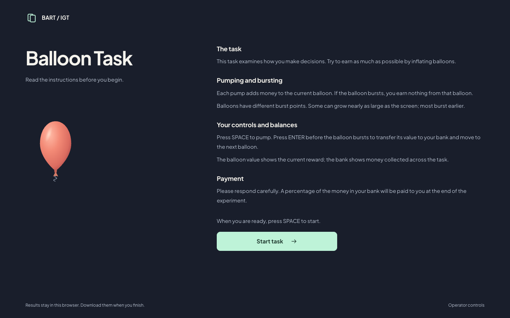
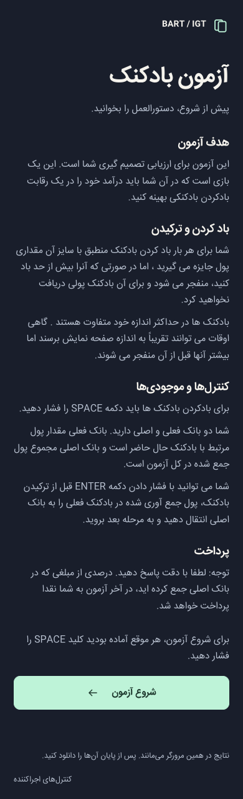

# BART / IGT experiment

A bilingual browser experiment for the Self-Assessment Manikin (SAM), video,
Iowa Gambling Task (IGT), and Balloon Analogue Risk Task (BART). The complete
interface has been rebuilt for the browser; PsychoPy remains an optional desktop
reference. The browser version needs no PsychoPy, VLC, packages or font installation.
Results stay local and can be downloaded as CSV, a compatible JSONL journal, and
a detailed session record.

## Run in your browser

From the repository root, start a local static server:

```sh
python3 -m http.server 8765 --bind 127.0.0.1
```

Open [the local experiment](http://127.0.0.1:8765/apps/browser/). English is the browser
default; choose Persian before starting. If Node is already available,
`node scripts/serve-browser.mjs` is an alternative launcher. No hosted service is required.

Study settings remain in `study/settings.py`. After changing them, run
`python3 scripts/export_study_settings.py` to regenerate browser configuration.
Defaults remain five trials per task. Download results after each session.

See [browser setup, configuration, recovery and protocol differences](docs/browser-experiment.md).
Validate browser timing, input and media on the actual workstation before
collecting participant data; the redesign is a new presentation version.

## Actual browser screenshots

Captured from the running application with scripted synthetic input, using the
existing Chrome browser without installing experiment software. These are actual
browser renders, not mockups or participant data.

### Session setup and instructions




### Ratings and card choices


### Balloon inflation

Only the balloon body grows upward. Its bottom attachment, knot and rope stay
fixed. The examples below show zero and twenty pumps at the same viewport size.
They use a documented no-burst test fixture to make the geometry comparison
repeatable; they are not naturally sampled participant outcomes.

 

<details>
<summary>Large balloon, Persian phone layout, and completion screen</summary>


 


</details>

[Full browser gallery and capture provenance](docs/screenshots/browser/README.md).
The captures demonstrate presentation and scripted flow, not physical timing or
behavioral equivalence. [Earlier native PsychoPy captures](docs/screenshots/desktop/README.md)
are retained as historical desktop evidence.

## Project layout

```text
apps/
  browser/         Browser interface and vendored runtime
  desktop/         Optional PsychoPy reference implementation
study/
  settings.py      Study configuration
  browser-settings.json  Generated browser configuration
  locales/         Shared instructions and translations
  tasks/           Python task rules
assets/            Fonts, stimulus images, videos and sounds
scripts/           Local server, configuration exporter and desktop captures
tests/
  browser/         Browser rule and session checks
  desktop/         Headless Python checks
docs/              Setup, architecture, decisions and screenshot galleries
requirements/      Optional Python dependency sets
archive/           Preserved historical results and media
```

See [architecture and naming conventions](docs/architecture.md) for ownership and
[the path migration guide](docs/project-structure.md) for old-to-new entry points.

## Optional desktop reference

The browser is the primary application. The original desktop implementation is
isolated in `apps/desktop/`; it requires PsychoPy and its desktop dependencies.
See [desktop setup, controls and result recovery](docs/desktop-experiment.md).
Browser use does not require those installations.

## Development

Browser unit checks require only an existing Node runtime:

```sh
node --test tests/browser/study-model.test.js
python3 scripts/export_study_settings.py --check
```

Python checks and browser integration instructions are in
[the development guide](docs/development.md). No participant data is uploaded;
new results remain ignored by Git. Historical workbooks are preserved under
`archive/results/` with their original names and unchanged contents.
