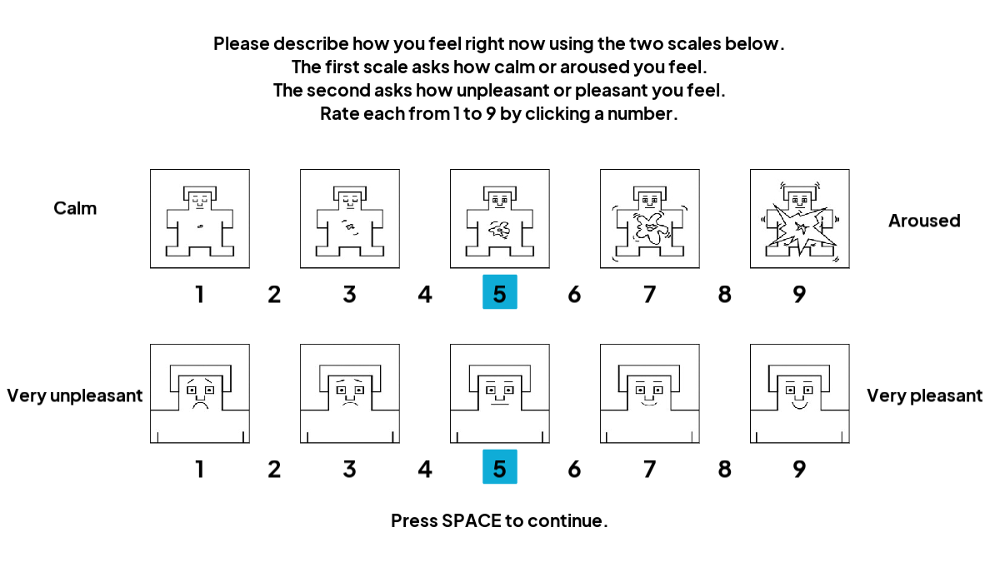
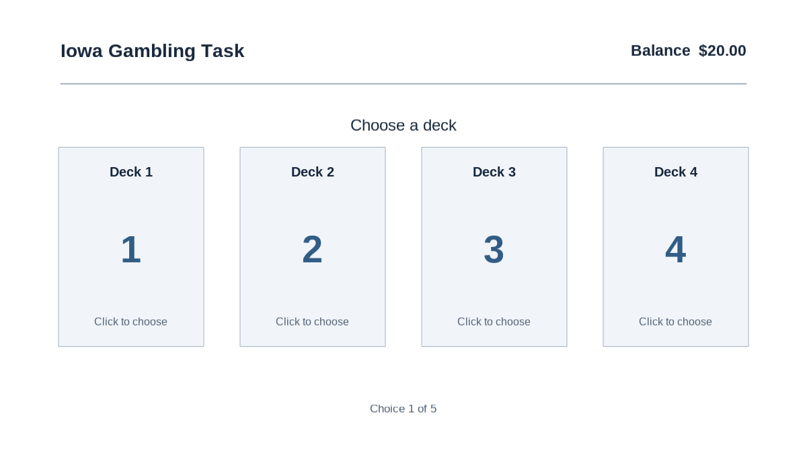
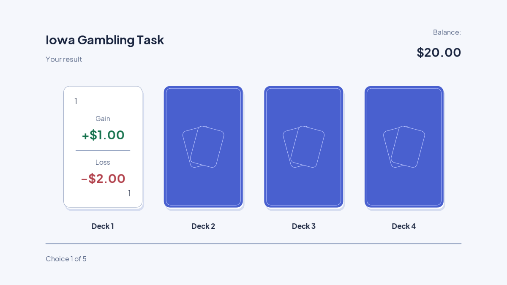
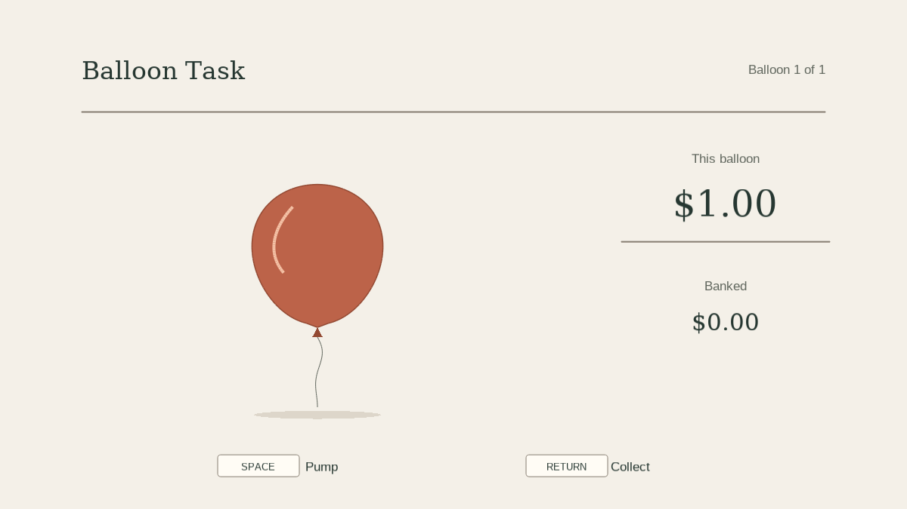

# BART / IGT experiment

A local PsychoPy experiment with Persian and English presentation. Participants complete a
Self-Assessment Manikin (SAM) survey, watch a negative, positive or neutral video,
complete a second survey, and perform the Iowa Gambling Task (IGT) and Balloon
Analogue Risk Task (BART). Results are written locally to Excel.

This is research software: review the study settings and validate the actual
workstation before collecting participant data. Defaults are five trials per task.

## English screenshots

Real PsychoPy-rendered English interface frames, captured on a disposable
GitHub-hosted runner with scripted demonstration input. No participant data or
local PsychoPy installation was used. These demonstrate presentation, not
hardware timing, audio, video playback or a complete participant session.









See the [full screenshot gallery and capture details](docs/screenshots/README.md)
and the [task design decisions](docs/ui-design.md).

## Setup and running

Use PsychoPy Standalone **2026.2.4**, or a desktop Python **3.11/3.12** environment
with PsychoPy installed. Install VLC of the same architecture as your Python
runtime, and install the supplied IRANSans fonts for Persian rendering. English uses Arial. Check the
rights to the fonts and other supplied media before redistributing them.

```sh
git clone https://github.com/Roobahist/bart_igt.git
cd bart_igt
```

The preferred route is to open `main.py` in PsychoPy Coder and run it. With a
compatible standalone Python environment, install dependencies and run:

```sh
python -m pip install -r requirements.txt
python main.py
```

PsychoPy installation needs platform-specific desktop, graphics and audio support;
see the [official installation guide](https://psychopy.org/download).
`main.py` is the single application entry point.
Importing `main` does not open a window or collect participant information.

## Configuration and controls

Edit `config.py`; there are no required environment variables or remote services.
Paths are resolved against the repository, so launching from another directory
works. Absolute paths are also accepted.

- `language`: `"fa"` (default Persian) or `"en"` (English), selecting a JSON catalog.
- `ui_theme`: shared task surface, border, text and outcome colors.
- `controls`: PsychoPy key names for advance, pump, collect, skip, replay, pause and abort;
  instructions display the configured keys.
- `which_video`: 1 negative, 2 positive, 3 neutral.
- `igt_skip`, `bart_skip`: set to 1 to skip the corresponding task.
- Trial counts, IGT gains/losses, BART capacity/reward, colors, fullscreen and
  feedback durations retain their existing setting names and defaults.
- `bart_blowing_factor`: `sys.maxsize` effectively disables held-key repeat.
  Positive finite values repeat every configured number of polling cycles;
  this is not a calibrated time interval. Value 1 pumps every poll.
- `column_order`: reorder the original columns, without adding/removing names.
- `output_directory`: defaults to `output`, relative to this repository.

Space advances instructions and surveys, and pumps a balloon. Enter banks a
balloon's reward on release. Mouse clicks select cards and survey ratings; both
survey ratings are required to continue. During video playback, `i` skips, `r`
replays and `p` toggles pause. During IGT/BART, `i` skips the remaining task.
Escape stops the session and retains completed responses.

Odd numeric subject codes run BART first; even or nonnumeric codes run IGT first.
IGT losses are shuffled independently per deck in complete configured blocks.
BART's conditional burst probability remains `1 / (capacity + 1 - pumps)`;
bursting at capacity is certain. Neither algorithm is reseeded automatically.

## Languages and injection

Set `language = "en"` in `config.py` to run in English. Persian remains the default.
Alternatively, inject the presentation dependency directly, without changing configuration:

```python
from localization import load_catalog
from main import run

run(catalog=load_catalog("en"))
```

`run()` passes this same catalog to IGT, BART and both surveys. Participant-facing
strings live in `locales/en.json` and `locales/fa.json`; fonts, script direction,
numeral rendering and rating button colors are also catalog data. English uses
Latin 1–9 text buttons; Persian keeps the original numeral images. IGT label/value
header positions follow the catalog's reading direction. Media are shared; choosing English
does not translate subtitles or speech embedded in video assets.

Edit a catalog to change wording, or load one from a separate directory with
the `directory` argument of `load_catalog`. A custom `LanguageCatalog` can also
be supplied through the `catalog` argument of `run`. Every catalog must cover the English catalog's message keys
and preserve each message's template parameter names. Templates receive live
trial counts, key names and amounts. Missing keys or mismatched parameters fail
before participant collection; there is no silent fallback to another language.
For image ratings, `rating_image_pattern` refers to configured numeral asset names;
set it to `null` for native text buttons.

Dialog labels and choices are translated, but stored column names, section names,
gender and handedness values remain canonical for compatible analysis. Select
and record the study language in the study protocol. Validate new wording and
rendering on the actual workstation before collecting data.

## Results and recovery

The workbook keeps the original column names and row layout: participant metadata
in the first data row, then completed surveys/trials. BART now records elapsed
trial time in the existing `RT` column. Skipped/incomplete balloons are neither
recorded as completed trials nor credited to the bank.

Each session receives a timestamp/UUID filename; subject codes never become paths.
Completed responses are flushed to a `.jsonl` journal before the final `.xlsx`
export. Workbooks are saved through a temporary file and atomically replaced.
Participant strings beginning with `=` remain literal text, not Excel formulas.
The journal is retained even after successful export.

To recover the **most recently modified journal** from the repository root:

```sh
python -c "from pathlib import Path; from session import recover; print(recover(max(Path('output').glob('*.jsonl'), key=lambda p: p.stat().st_mtime)))"
```

This creates a separate `-recovered.xlsx` file. Recovery tolerates an incomplete
last journal record following a crash, but rejects malformed complete records.
It does not resume the experiment. Recovery only needs `requirements-results.txt`.
Disk-full errors are surfaced; verify successful export and storage capacity.

Both journals and workbooks contain participant information. Store them in an
access-controlled location with appropriate backups and retention. New outputs
are ignored by Git. Historical workbooks already in the repository remain intact;
ignore rules do not remove them or erase Git history. Do not upload new study data.

## Development and verification

Headless development does not require PsychoPy, VLC, a display or an audio device:

```sh
python -m venv .venv
source .venv/bin/activate
python -m pip install -r requirements-dev.txt
ruff check .
ruff format --check .
python -m unittest discover -s tests -v
python -m compileall -q main.py bart.py igt.py config.py session.py localization.py ui.py
pip-audit --strict --no-deps --disable-pip -r requirements-results.txt
```

On Windows, activate the environment with `.venv\Scripts\activate`.
CI runs these headless checks on Python 3.11. Its vulnerability scan covers the
pinned result-storage dependency closure; it does not certify the entire PsychoPy
installation. On the actual experiment workstation also run `python -m pip check`
and `pip-audit` against its installed environment. Dependabot proposes monthly
updates; major Python dependency updates are excluded from automatic proposals.
There is no production deployment target. Docker and CD are unnecessary for this
interactive desktop experiment.

## Architecture and limitations

- `main.py`: participant dialog, presentation, input and session orchestration.
- `ui.py`: native task screens, card reveal, shared instruction layout and injected theme.
- `igt.py`, `bart.py`: task randomization, independently testable without PsychoPy.
- `session.py`: counterbalancing, setting/asset validation, journaling and export.
- `config.py`: study parameters, language, controls and media paths.
- `localization.py`, `locales/`: injectable catalogs and language-specific text/rendering data.
- `images/`, `videos/`, `sounds/`, `fonts/`: existing experiment assets.
- `tests/`: task rules, scripted BART input, orchestration and storage regressions.

See [architecture](docs/architecture.md), [modernization findings](docs/modernization.md)
and the [manual workstation checklist](docs/workstation-checks.md).

Automated tests simulate input and presentation; they cannot establish real frame,
keyboard, audio or video timing. RT is elapsed wall time using a monotonic clock,
not validated stimulus-to-response hardware timing. Sound feedback now uses
preloaded asynchronous PsychoPy audio, and polling yields briefly rather than
spinning continuously; validate these protocol changes before research use.
The global presentation state remains intentionally confined to one desktop
session. Simultaneous/reentrant sessions are not supported. No clinical validity,
participant payout policy or scientific protocol validation is implied.
