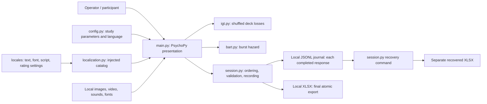

# Architecture

The application is one local process with one participant session at a time.
No servers, network integrations, databases or deployment services are involved.

`run()` owns the session lifecycle. It validates configuration/assets, collects
metadata, resets IGT decks, opens the window, runs the experiment and cleans up.
Task errors propagate after exporting partial results; they never trigger task
replays. Canceling the initial dialog creates no session files. Escape exits with
completed responses retained. Video/window cleanup failures cannot prevent export.

The two task modules depend only on configuration and Python's random generator.
Optional generator arguments permit deterministic tests. No dependency injection
framework or general task interface is needed for two small domain functions.

The journal header stores column order. Each following line is one result record.
Append flushes and syncs before returning; the workbook is assembled separately
using openpyxl. The journal survives failed exports or process interruption.

Archify is unavailable in this environment. This source-backed Mermaid overview
is a small, editable fallback; no Archify generation or validation is claimed.

Presentation dependency: `run(catalog=None)` loads the configured language when
no catalog is supplied, then passes that object explicitly into `igt_experiment`,
`bart_experiment` and `survey`. Translations remain independent of task rules.
There is no global language switch or dependency injection framework. Catalog
coverage and template parameters are checked before opening the participant dialog.
