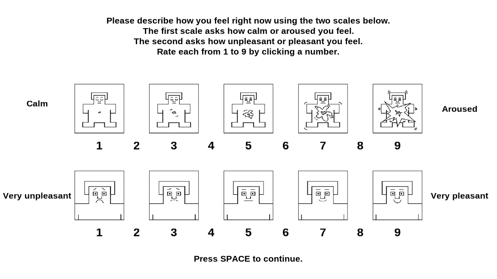
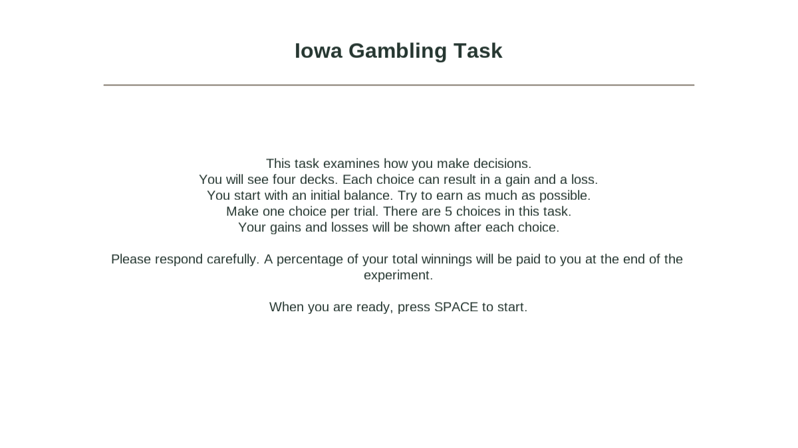
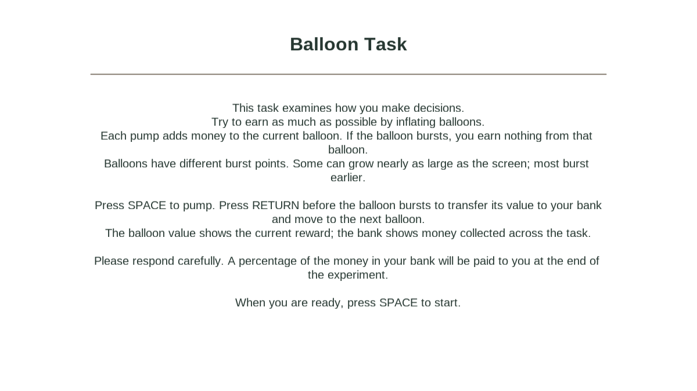
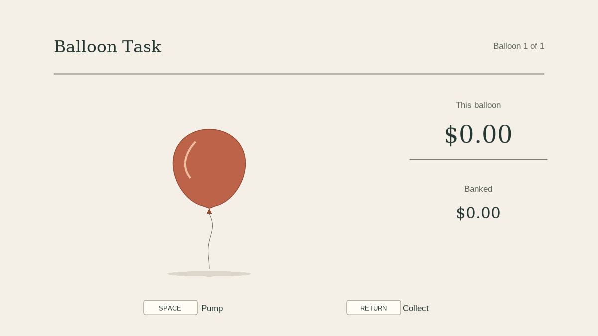
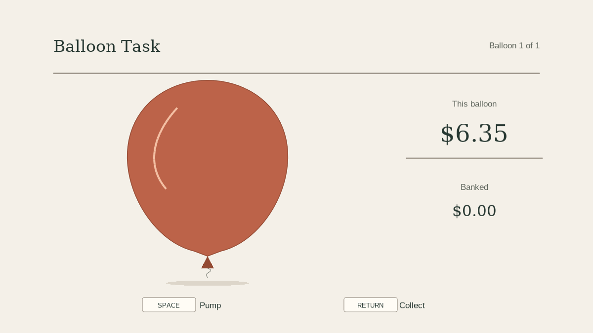

# English interface screenshots

These screenshots are real frames rendered by PsychoPy 2026.2.4 on a disposable
Ubuntu GitHub-hosted runner using an Xvfb virtual display and software OpenGL.
They use the application's current English task and survey rendering functions,
with scripted input and synthetic responses. No participant information is present.
Nothing was installed on the owner's machine.

This is an automated presentation demonstration, not a completed human participant
session or a validation of keyboard hardware, physical display timing, audio,
VLC video playback or the participant dialog. Video content was not captured.
The SAM demonstration selects 5 on both scales. The IGT chooses deck 1 for five
trials with seeded randomness. BART collects one balloon after twenty pumps and a separate seeded
demonstration after 127 pumps, with audio muted. Neither uses forced outcomes. Exact runtime/source details are in [provenance.json](provenance.json).
The [successful hosted run](https://github.com/Roobahist/bart_igt/actions/runs/38172580303)
used PsychoPy 2026.2.4 and Python 3.11.17.

The task redesign uses printed deck backs and a light selected card containing
gain/loss labels and amounts. BART uses a native vector balloon, a separate reward
ledger and keyboard legends. Balloon artwork, position and visual growth range
have changed; task probabilities and rewards are retained. See
[the design decisions](../ui-design.md) for rationale and protocol implications.

## Screens

### SAM survey

### Iowa Gambling Task

### Balloon Analogue Risk Task

## Reproducing the capture

Run the **English screenshots** workflow manually from GitHub Actions after this
workflow is merged. It installs PsychoPy only on an ephemeral hosted runner and
uploads an `english-screenshots` artifact. Download and inspect that artifact before
updating checked-in screenshots. No workflow automatically writes to the repository.

The capture script calls the application's native renderers and captures the
OpenGL back buffer immediately before the actual window flip, using PsychoPy's
`Window.getMovieFrame` API. This avoids unreliable front-buffer reads in virtual
displays. It does not draw substitute/mock screens or use generated illustrations.
