# Browser screenshots

Genuine frames from the redesigned browser experiment using jsPsych 8.3.0,
scripted synthetic input and English/Persian catalogs. Captures were made locally
in the already-installed Chrome using an isolated temporary profile; no PsychoPy,
VLC, fonts, browser or experiment dependencies were installed on the machine.

These demonstrate the actual running UI. They do not validate physical timing,
complete participant sessions, audio perception or scientific equivalence.
The full [provenance](provenance.json) records the browser, viewport, RNG fixtures
and tested behavior. No participant data is included. The 20/127-pump growth
captures use an explicit no-burst RNG fixture to inspect layout; a separate trial
tests an explosion. These are not natural sampled behavioral results.

## English desktop

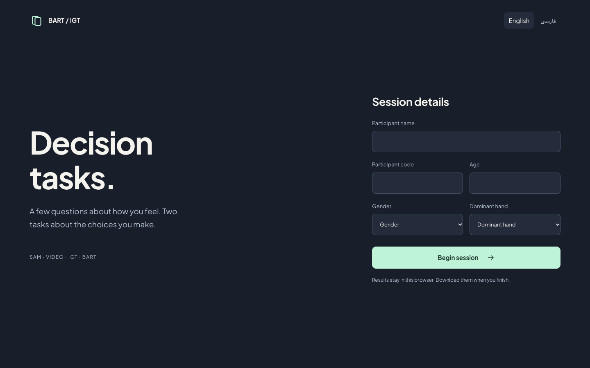
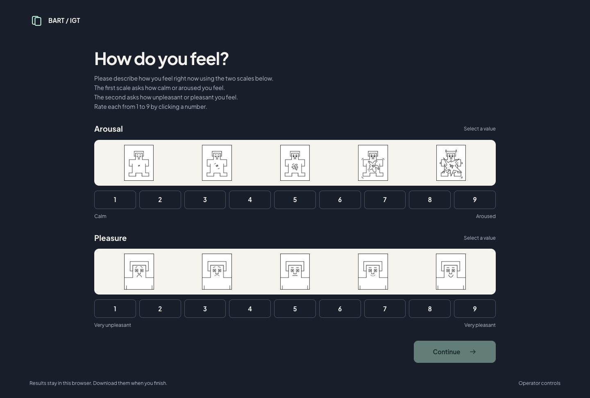
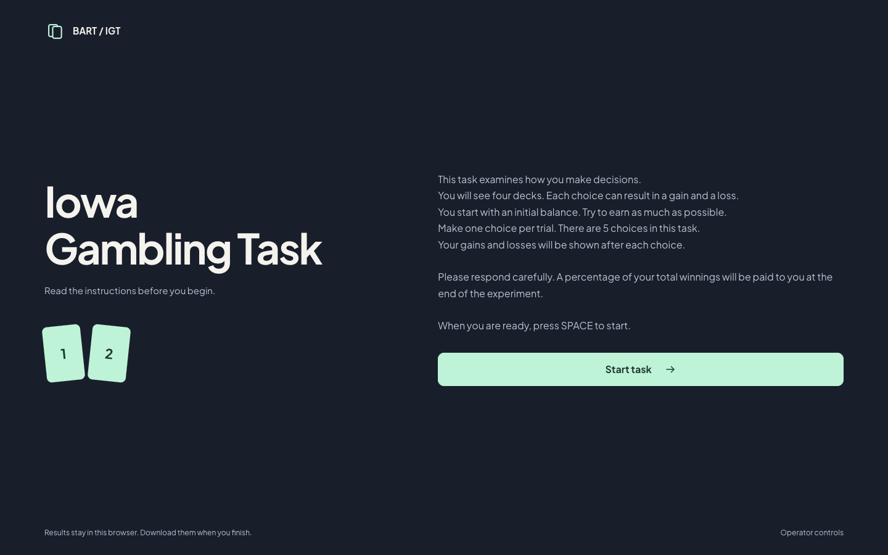
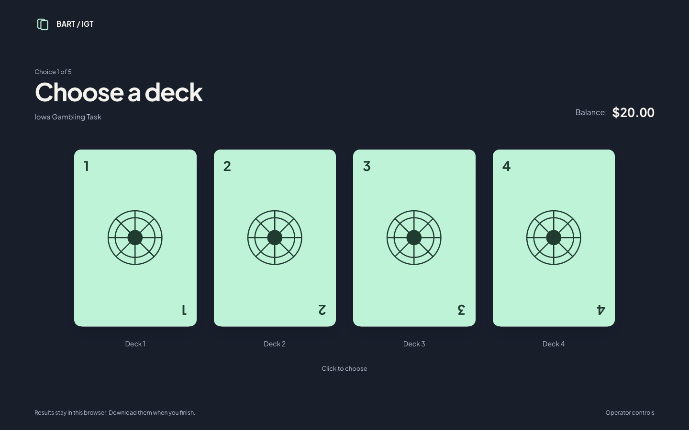
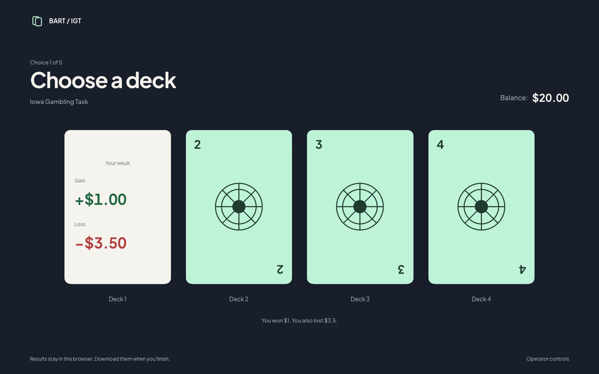
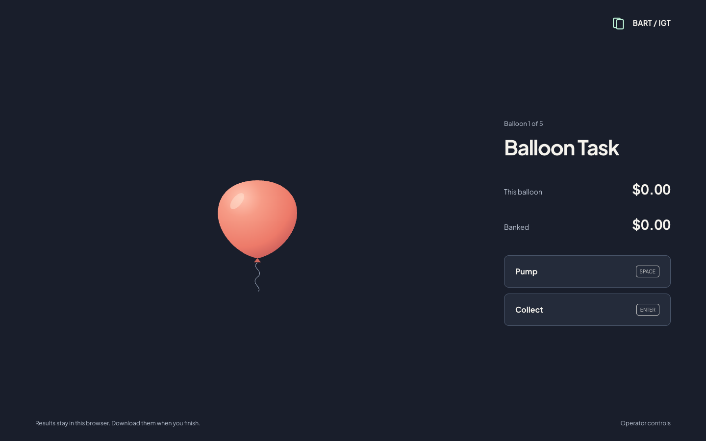
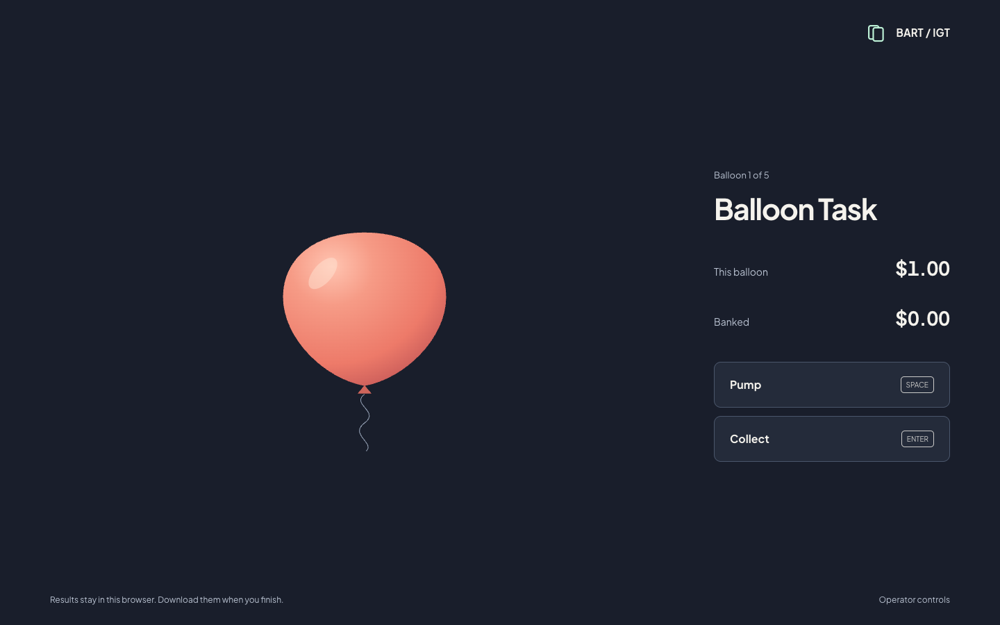
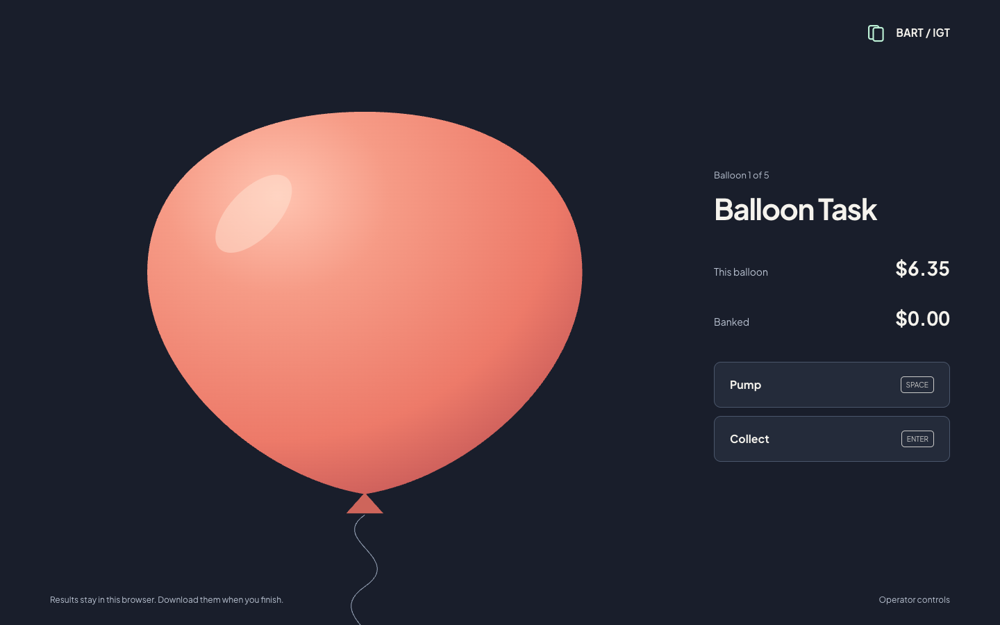
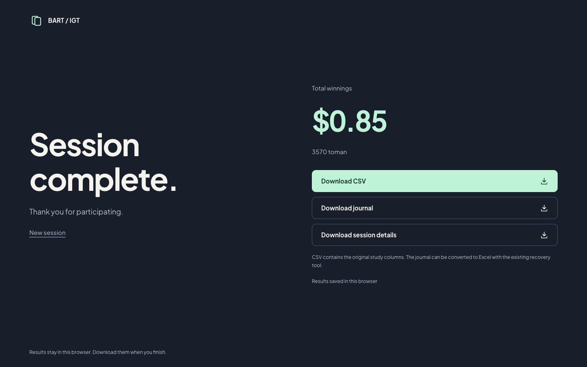

## Phone and Persian

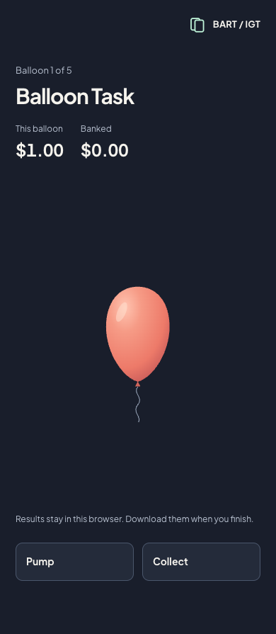
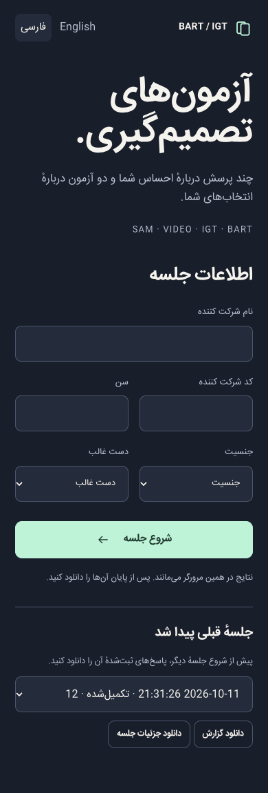
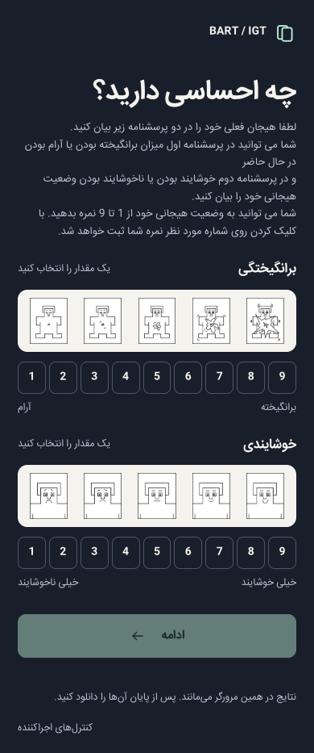
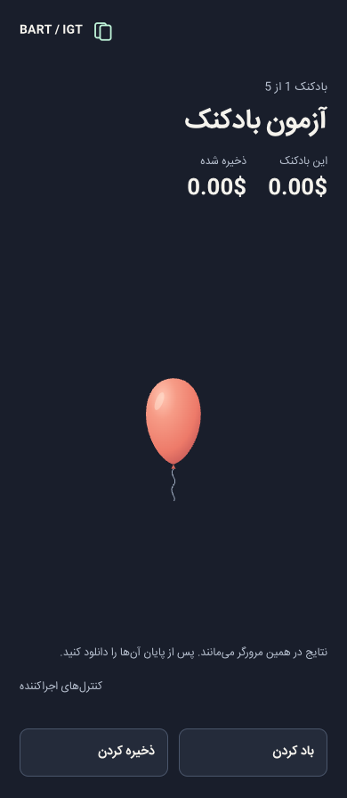
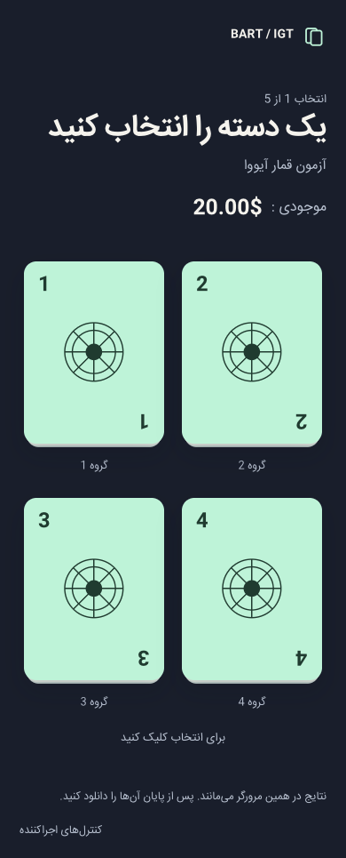
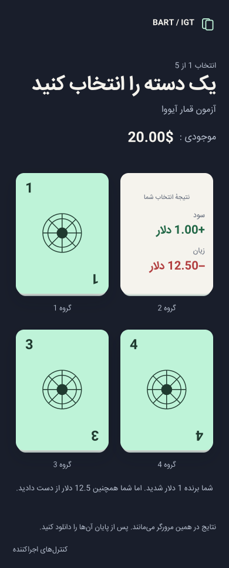

## Reproduce

`web/tests/browser.cjs` uses Playwright with the locally served repository.
The **Browser checks** workflow installs test tooling on an ephemeral runner,
tests the actual flow and uploads captures. Source code does not require those
test dependencies to run. Provenance travels with regenerated images; desktop
and browser screenshots are labeled separately.
